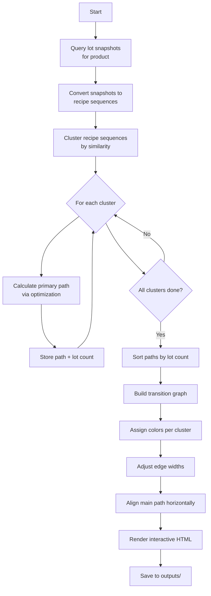
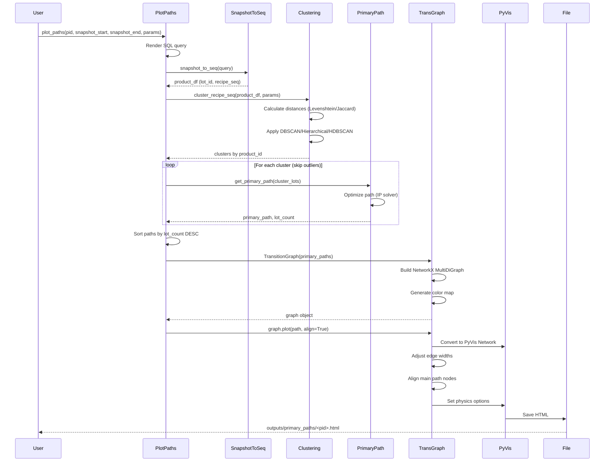

# Product Primary Path Visualization

## Overview

Visualizes multiple manufacturing paths for a product as an interactive network graph, showing stage transitions colored by path cluster. Helps identify common routing patterns and variations.

## API Endpoint (Path Statistics)

```http
POST /api/v1/paths_stats
```

Request body:

```json
{
    "snapshot_start": "2024-01-01T00:00:00",
    "snapshot_end": "2024-01-31T23:59:59",
    "product_ids": ["HB123"],
    "rules": {
        "clustering_method": "dbscan",
        "distance_metric": "levenshtein",
        "eps": 2,
        "min_samples": 2,
        "primary_cluster_ratio": 0.6,
        "sol_timeout": 300
    }
}
```

Response shape:

```json
{
    "products": [
        {
            "product_id": "HB123",
            "clusters": [
                {
                    "cluster_id": 1,
                    "lot_count": 42,
                    "wafer_qty": 1050,
                    "path": ["DIFF", "LITHO", "ETCH"],
                    "time_stats": {
                        "earliest_start": "2024-01-02T08:00:00",
                        "latest_start": "2024-01-28T09:30:00",
                        "mean_start": "2024-01-14T10:05:00",
                        "median_start": "2024-01-14T08:00:00"
                    },
                    "type": "Primary"
                }
            ]
        }
    ]
}
```

## Script

```bash
python -m wip_analysis.hwm.product_level.plot_paths
```

### Example Usage

```python
from datetime import datetime

from wip_analysis.hwm.product_level.plot_paths import plot_paths

# Plot paths for a product with clustering
plot_paths(
    pid="zVUuBTVNGzerHRdfHW8qYg==",
    snapshot_start=datetime(2024, 1, 1, 0, 0, 0),
    snapshot_end=datetime(2024, 1, 31, 23, 59, 59),
    clustering_method="dbscan",
    distance_metric="levenshtein",
    eps=2,
    min_samples=2,
    primary_cluster_ratio=0.6,
    sol_timeout=300
)
```

**Output**: Interactive HTML file at `outputs/primary_paths/<product_id>.html`

## Core Function

### `plot_paths(pid, snapshot_start, snapshot_end, align=True, sol_timeout=300, **cluster_params)`

**Location**: `wip_analysis/hwm/product_level/plot_paths.py`

Creates interactive network graph showing multiple primary paths for a product.

#### Parameters

- `pid` (str): Product identifier (or "ALL" for all products)
- `snapshot_start` (datetime): Inclusive start of snapshot window
- `snapshot_end` (datetime): Inclusive end of snapshot window
- `align` (bool): Whether to align path graph layout (default: True)
- `sol_timeout` (int): Timeout in seconds for primary path optimization (default: 300)
- `**cluster_params`: Parameters passed to clustering algorithm
  - `clustering_method`: "hdbscan" (by default), "hierarchical", or "dbscan"
  - `min_samples` (int): Minimum cluster size (default: 2)
  - `primary_cluster_ratio` (float): Required ratio for primary cluster (0.0-1.0)
  - `eps` (float, optional): DBSCAN epsilon parameter

#### Return Value

None (saves HTML file to `outputs/primary_paths/`)

## Processing Pipeline



## Implementation Details

### 1. Data Retrieval

**SQL Query**: `get_pid_snapshots.sql.j2`

```sql
SELECT 
    lot_id,
    stage_name,
    stage_time,
    created_at as snapshot_cut
FROM lot_progress
WHERE product_id = {{ product_id }}
  AND stage_type IN ('actual', 'interpolated')
ORDER BY lot_id, stage_time
```

**Conversion to Sequences**:

```python
def snapshot_to_seq(query: str) -> pl.DataFrame:
    """
    Convert lot snapshots to recipe sequences.
    
    Input:
        lot_id | stage_name | stage_time          | snapshot_cut
        -------|------------|---------------------|-------------
        LOT001 | DIFF       | 2024-01-01 08:00:00 | 2024-01-02
        LOT001 | LITHO      | 2024-01-01 14:00:00 | 2024-01-02
        LOT001 | ETCH       | 2024-01-02 09:00:00 | 2024-01-02
    
    Output:
        lot_id | product_id | recipe_seq
        -------|------------|----------------
        LOT001 | HB123      | ['DIFF', 'LITHO', 'ETCH']
    """
    df = fetch_data(query)
    return (
        df.group_by("lot_id")
        .agg([
            pl.col("stage_name").sort_by("stage_time").alias("recipe_seq"),
            pl.col("product_id").first()
        ])
    )
```

### 2. Sequence Clustering

**Function**: `cluster_recipe_seq(df, clustering_method, distance_metric="levenshtein", **params)`

Groups similar manufacturing paths using configurable distance metrics.

**Distance Metrics**:

The function supports two distance metrics via the `distance_metric` parameter:

#### Levenshtein Distance (default)

Edit distance that considers both element differences and order. Suitable when sequence order matters.

```python
from rapidfuzz.distance import Levenshtein

# Example sequences
seq1 = ['DIFF', 'LITHO', 'ETCH', 'CLEAN']
seq2 = ['DIFF', 'LITHO', 'ETCH', 'MEASURE']
seq3 = ['DIFF', 'PHOTO', 'ETCH', 'CLEAN']

distance_1_2 = Levenshtein.distance(seq1, seq2)  # 1 (one substitution)
distance_1_3 = Levenshtein.distance(seq1, seq3)  # 1 (one substitution)
distance_2_3 = Levenshtein.distance(seq2, seq3)  # 2 (two substitutions)
```

#### Jaccard Distance

Set-based distance that ignores order and only considers which stages are present. Suitable when only the set of stages matters, not their order.

```python
# Jaccard distance treats sequences as sets
seq1 = ['DIFF', 'LITHO', 'ETCH', 'CLEAN']
seq2 = ['ETCH', 'CLEAN', 'DIFF', 'LITHO']  # Same stages, different order
seq3 = ['DIFF', 'LITHO', 'ETCH']  # Missing CLEAN

# Jaccard distance = 1 - Jaccard similarity
# Jaccard similarity = |A ∩ B| / |A ∪ B|
jaccard_1_2 = 1 - (4/4)  # 0.0 (identical sets)
jaccard_1_3 = 1 - (3/4)  # 0.25 (3 common, 4 total unique)
```

**Usage**:

```python
# Use Levenshtein distance (default, order-sensitive)
clusters = cluster_recipe_seq(
    df, 
    clustering_method="dbscan",
    distance_metric="levenshtein",
    eps=2,
    min_samples=2
)

# Use Jaccard distance (order-insensitive, set-based)
clusters = cluster_recipe_seq(
    df,
    clustering_method="dbscan", 
    distance_metric="jaccard",
    eps=0.3,  # Note: Jaccard distance is in [0, 1]
    min_samples=2
)
```

**Clustering Methods**:

#### DBSCAN (Density-Based)

```python
labels = _cluster_dbscan(
    dist_matrix,
    pid_eps=eps,              # Max distance for neighborhood
    min_samples=min_samples,  # Min points for core point
    primary_cluster_ratio=0.6  # Require 60% in main cluster
)
```

**Auto-epsilon**: If `eps=None`, uses knee detection on k-distance graph

```python
neighbors = NearestNeighbors(n_neighbors=min_samples, metric='precomputed')
neighbors.fit(dist_matrix)
distances, _ = neighbors.kneighbors(dist_matrix)
k_distances = np.sort(distances[:, -1])

kneedle = KneeLocator(
    range(len(k_distances)), 
    k_distances, 
    curve='convex', 
    direction='increasing'
)
eps = k_distances[kneedle.knee]
```

#### Hierarchical Clustering

```python
labels = _cluster_hierarchical(
    dist_matrix,
    primary_cluster_ratio=0.6  # Require 60% in largest cluster
)
```

**Algorithm**: Agglomerative clustering with dynamic threshold

```python
for n_clusters in range(2, n_seqs + 1):
    clustering = AgglomerativeClustering(
        n_clusters=n_clusters,
        metric='precomputed',
        linkage='average'
    )
    labels = clustering.fit_predict(dist_matrix)
    
    # Find largest cluster
    unique, counts = np.unique(labels, return_counts=True)
    max_cluster_size = counts.max()
    main_cluster_ratio = max_cluster_size / n_seqs
    
    if main_cluster_ratio >= primary_cluster_ratio:
        return labels  # Found suitable clustering
```

#### HDBSCAN (Hierarchical DBSCAN)

```python
labels = _cluster_hdbscan(
    dist_matrix,
    min_samples=min_samples
)
```

**Cluster Output**:

```python
{
    "HB123": [
        {
            "cluster_id": 0,  # Outliers
            "cluster_lots": {
                "LOT999": ['DIFF', 'SPECIAL', 'ETCH']
            }
        },
        {
            "cluster_id": 1,  # Main path
            "cluster_lots": {
                "LOT001": ['DIFF', 'LITHO', 'ETCH', 'CLEAN'],
                "LOT002": ['DIFF', 'LITHO', 'ETCH', 'CLEAN'],
                ...
            }
        },
        {
            "cluster_id": 2,  # Variant path
            "cluster_lots": {
                "LOT010": ['DIFF', 'LITHO', 'ETCH', 'MEASURE'],
                ...
            }
        }
    ]
}
```

### 3. Primary Path Calculation

**Function**: `get_primary_path(lot_seqs_dict, sol_timeout=300)`

Finds the sequence that minimizes total edit distance to all sequences in cluster.

**Optimization Problem**:

```
Minimize: Σ Levenshtein(primary_path, seq_i) for all i in cluster

Subject to:
- primary_path is a valid sequence
- stages in primary_path exist in at least one seq_i
```

**Input**:

```python
lot_seqs = {
    "LOT001": ['DIFF', 'LITHO', 'ETCH', 'CLEAN'],
    "LOT002": ['DIFF', 'LITHO', 'ETCH', 'CLEAN'],
    "LOT003": ['DIFF', 'LITHO', 'ETCH'],
}
```

**Output**:

```python
primary_path = ['DIFF', 'LITHO', 'ETCH', 'CLEAN']  # Most representative
```

**Algorithm**: Uses integer programming or heuristic search (implementation in `stage_permutate.py`)

### 4. Graph Construction

**Class**: `TransitionGraph(primary_paths)`

```python
class TransitionGraph:
    def __init__(self, primary_paths: list[tuple[list[str], int]]):
        """
        Args:
            primary_paths: [(path, lot_count), ...]
            
        Example:
            [
                (['DIFF', 'LITHO', 'ETCH'], 50),    # Cluster 1: 50 lots
                (['DIFF', 'PHOTO', 'ETCH'], 20),    # Cluster 2: 20 lots
                (['DIFF', 'LITHO', 'MEASURE'], 10), # Cluster 3: 10 lots
            ]
        """
```

**Edge Creation**:

```python
edges = []
for cluster_idx, (primary_path, lot_cnt) in enumerate(primary_paths):
    for j in range(1, len(primary_path)):
        edge = (
            primary_path[j-1],  # source stage
            primary_path[j],    # target stage
            {
                "cnt": lot_cnt,        # lot count on this transition
                "cluster": cluster_idx  # which cluster this belongs to
            }
        )
        edges.append(edge)

# Build directed multigraph (allows multiple edges between same nodes)
G = nx.MultiDiGraph(edges)
```

**Example Graph Structure**:

```
Nodes: ['DIFF', 'LITHO', 'PHOTO', 'ETCH', 'CLEAN', 'MEASURE']

Edges:
  DIFF -> LITHO   [cluster=0, cnt=50]
  DIFF -> LITHO   [cluster=2, cnt=10]
  DIFF -> PHOTO   [cluster=1, cnt=20]
  LITHO -> ETCH   [cluster=0, cnt=50]
  LITHO -> MEASURE [cluster=2, cnt=10]
  PHOTO -> ETCH   [cluster=1, cnt=20]
  ETCH -> CLEAN   [cluster=0, cnt=50]
```

### 5. Visualization

**Edge Coloring**: Each cluster gets unique deterministic color

```python
def name_to_color(category):
    import hashlib, colorsys
    
    h = int(hashlib.md5(str(category).encode()).hexdigest(), 16)
    hue = (h % 360) / 360.0
    r, g, b = colorsys.hls_to_rgb(hue, 0.55, 0.65)
    return f"#{int(r*255):02X}{int(g*255):02X}{int(b*255):02X}"

color_map = {
    0: "#4A90E2",  # Cluster 0 - blue
    1: "#E24A4A",  # Cluster 1 - red
    2: "#4AE290",  # Cluster 2 - green
}
```

**Edge Width**: Proportional to lot count

```python
def _adjust_edge_width(net, min_width=0.1, max_width=10, distinguish=False):
    weights = [edge["cnt"] for edge in net.edges]
    min_weight = min(weights)
    max_weight = max(weights)
    
    for edge in net.edges:
        weight = edge["cnt"]
        if not distinguish:
            # Linear scaling
            width = ((weight - min_weight) / (max_weight - min_weight)) * 
                    (max_width - min_width) + min_width
        else:
            # Direct mapping
            width = weight
        edge["width"] = width
```

**Node Alignment**: Main path laid out horizontally

```python
def _align(net, x_gap=200, y_fixed=0):
    """Align first primary path horizontally, others physics-based."""
    main_path = primary_paths[0][0]  # Largest cluster
    
    # Fix main path nodes horizontally
    for i, node_id in enumerate(main_path):
        node = net.get_node(node_id)
        node["x"] = i * x_gap        # Evenly spaced
        node["y"] = y_fixed          # Same y-coordinate
        node["fixed"] = {"x": True, "y": True}
    
    # Other nodes: free positioning via physics
```

**Physics Settings**: For dynamic layout of non-aligned nodes

```javascript
{
  "physics": {
    "enabled": true,
    "stabilization": false,
    "barnesHut": {
      "gravitationalConstant": -2500,
      "centralGravity": 0.3,
      "springLength": 300,
      "springConstant": 0.02,
      "damping": 0.4
    }
  }
}
```

## Data Flow



## Output Visualization

### Interactive HTML Features

1. **Node Interaction**
   - Hover: Shows stage name
   - Drag: Reposition non-fixed nodes
   - Click: Highlight connected edges

2. **Edge Interaction**
   - Hover: Shows lot count tooltip
   - Color: Indicates cluster membership
   - Width: Proportional to lot throughput

3. **Controls**
   - Zoom: Mouse wheel
   - Pan: Click and drag background
   - Physics: Toggle on/off for stability

### Visual Example

Paths derived from different clusters will have different colors. The line width is proportional to the number of lots.

1. When `align=False`, the primary path with the largest lot quantity won't be aligned in a straight line:

   

2. When `align=True`, the primary path with the largest lot quantity will be aligned in a straight line:

   

## Use Cases

### 1. Process Standardization

```python
# Find dominant paths and identify variations
plot_paths(
    pid="HB123",
    snapshot_start=datetime(2024, 1, 1, 0, 0, 0),
    snapshot_end=datetime(2024, 1, 31, 23, 59, 59),
    clustering_method="dbscan",
    min_samples=3,              # Ignore paths with < 3 lots
    primary_cluster_ratio=0.8   # Main path should be 80%+ of lots
)
```

**Analysis**:

- If main cluster < 80%, process is inconsistent
- Identify why some lots take alternate routes
- Standardize to primary path when possible

## Performance Considerations

- **Clustering Time**: O(n²) for distance matrix, where n = number of lots
  - 100 lots: ~1 second
  - 1000 lots: ~60 seconds
- **Primary Path Optimization**: O(2^m) worst case, where m = number of unique stages
  - Timeout prevents runaway (default: 300s)
- **Rendering**: O(e) where e = number of edges
  - Typically fast (< 1s) for reasonable graphs

## Limitations

1. **Snapshot Dependency**: Only sees stages present in snapshots, may miss transient stages
2. **Clustering Sensitivity**: Results depend on method choice and parameters
3. **Path Optimization**: May timeout for highly complex routing (many variants)
4. **Visual Clarity**: Graph can become cluttered with >10 clusters or >50 stages

## Related Functions

- `get_pid_primary_path()` - Single primary path (most common)
- `snapshot_to_seq()` - Convert snapshots to sequences
- `cluster_recipe_seq()` - Sequence clustering with configurable distance metrics
- `get_primary_path()` - Optimize path for cluster

## Related Documentation

- [02-product-level-hwm.md](./02-product-level-hwm.md) - Product statistics
- [09-primary-path.md](./09-primary-path.md) - Primary path calculation

