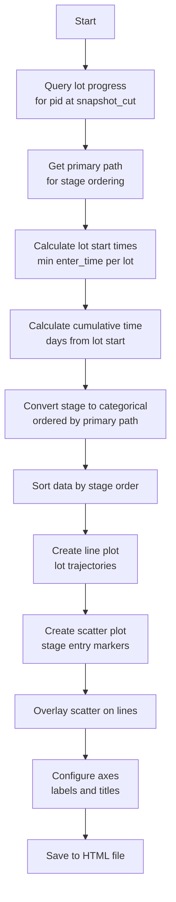
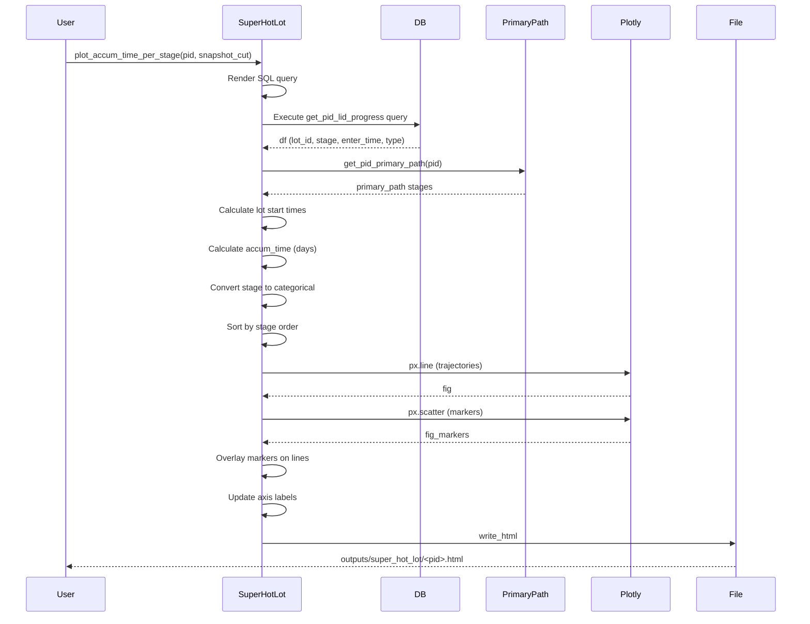

# Super Hot Lot Visualization

## Overview

Visualizes lot progress over time as accumulative timeline plots, showing when each lot entered different manufacturing stages. Useful for comparing cycle times and identifying fast/slow lots.

## Script

```python
from wip_analysis.hwm.product_level.super_hot_lot import plot_accum_time_per_stage

# Plot lot timelines for a product at specific snapshot
plot_accum_time_per_stage(
    pid="i2M8chm9LxtBBE58a2JJJg==",
    snapshot_cut="2024-10-05 08:34:15"
)
```

**Output**: Interactive HTML file at `outputs/super_hot_lot/<product_id>.html`

## Core Function

### `plot_accum_time_per_stage(pid, snapshot_cut)`

**Location**: `wip_analysis/hwm/product_level/super_hot_lot.py`

Creates interactive timeline visualization showing lot progress through stages.

#### Parameters
- `pid` (str): Product identifier
- `snapshot_cut` (str): Timestamp for snapshot (ISO format: "YYYY-MM-DD HH:MM:SS")

#### Return Value
None (saves HTML file to `outputs/super_hot_lot/`)

## Processing Logic



## Implementation Details

### 1. Data Query

**SQL Template**: `get_pid_lid_progress.sql.j2`
```sql
SELECT 
    lot_id,
    stage_name,
    stage_type,
    enter_time
FROM lot_progress
WHERE product_id = {{ pid }}
  AND created_at = {{ snapshot_cut }}
  AND stage_type IN ('actual', 'interpolated')
ORDER BY lot_id, enter_time
```

**Output**:
```python
   lot_id  | stage_name | stage_type   | enter_time
-----------|------------|--------------|-------------------
LOT001     | DIFF       | actual       | 2024-01-01 08:00
LOT001     | LITHO      | interpolated | 2024-01-02 10:00
LOT001     | ETCH       | actual       | 2024-01-03 14:00
LOT002     | DIFF       | actual       | 2024-01-01 09:00
LOT002     | LITHO      | actual       | 2024-01-02 15:00
```

### 2. Primary Path Ordering

**Function**: `get_pid_primary_path(pid)`
```python
primary_path = get_pid_primary_path("i2M8chm9LxtBBE58a2JJJg==")
# Returns: ['DIFF', 'LITHO', 'ETCH', 'CLEAN', 'MEASURE', 'PACK']
```

**Purpose**: Ensures stages displayed in manufacturing order (bottom to top)

### 3. Cumulative Time Calculation

**Algorithm**:
```python
# Find lot start time (earliest enter_time per lot)
df["lot_start"] = df.groupby("lot_id")["enter_time"].transform("min")

# Calculate days from start
df["accum_time"] = (df["enter_time"] - df["lot_start"]).dt.total_seconds() / (24 * 3600)
```

**Example**:
```python
lot_id  | enter_time          | lot_start           | accum_time (days)
--------|---------------------|---------------------|------------------
LOT001  | 2024-01-01 08:00:00 | 2024-01-01 08:00:00 | 0.0
LOT001  | 2024-01-02 10:00:00 | 2024-01-01 08:00:00 | 1.083  (26 hours)
LOT001  | 2024-01-03 14:00:00 | 2024-01-01 08:00:00 | 2.25   (54 hours)
LOT002  | 2024-01-01 09:00:00 | 2024-01-01 09:00:00 | 0.0
LOT002  | 2024-01-02 15:00:00 | 2024-01-01 09:00:00 | 1.25   (30 hours)
```

### 4. Stage Categorization

**Purpose**: Control y-axis ordering and enable proper sorting

```python
import pandas as pd

# Convert stage to categorical with primary_path ordering
df["stage_name"] = pd.Categorical(
    df["stage_name"], 
    categories=primary_path, 
    ordered=True
)

# Sort by stage order (important for line plot connectivity)
df = df.sort_values("stage_name")
```

**Effect**:
- Y-axis shows stages in manufacturing sequence
- Lines connect stages in correct order
- Unknown stages (not in primary_path) handled gracefully

### 5. Visualization Creation

**Lines (Lot Trajectories)**:
```python
import plotly.express as px

fig = px.line(
    df,
    x="accum_time",
    y="stage_name",
    color="lot_id",
    markers=False,
    category_orders={"stage_name": primary_path[::-1]}  # Reverse for bottom-to-top
)
```

**Markers (Stage Entries)**:
```python
fig_markers = px.scatter(
    df,
    x="accum_time",
    y="stage_name",
    color="lot_id",           # Match line colors
    symbol="stage_type",      # Different shapes: actual vs interpolated
    category_orders={"stage_name": primary_path[::-1]}
)

# Overlay markers on lines
fig.add_traces(fig_markers.data)
```

**Axis Configuration**:
```python
fig.update_yaxes(title="Stage")
fig.update_xaxes(title="Cumulative Days")
```

### 6. File Output

```python
from pathlib import Path

output_dir = Path("outputs/super_hot_lot")
output_dir.mkdir(parents=True, exist_ok=True)

# Sanitize product_id for filename (replace / with _)
filename = f"{pid.replace('/', '_')}.html"
fig.write_html(output_dir / filename)
```

## Data Flow



## Analysis Use Cases

### 1. Identify Fast Lots ("Hot Lots")

**Question**: Which lots completed fastest through the fab?

**How to Identify**:
- Look for lots reaching top stages earliest (leftmost markers at top)
- Compare total cycle time (max accum_time per lot)
- Analyze stage-by-stage progression

**Example Analysis**:
```python
plot_accum_time_per_stage("HB123", "2024-10-05 08:00:00")

# In plot, observe:
# - Lot A reaches PACK at day 15 (fast)
# - Lot B reaches PACK at day 25 (slow)
# - Lot C reaches PACK at day 18 (medium)

# Investigation:
# - Why is Lot A faster? Priority handling? Better equipment?
# - Why is Lot B slower? Rework? Queue delays?
```

### 2. Detect Bottleneck Stages

**Question**: Where do lots spend disproportionate time?

**How to Identify**:
- Look for large horizontal gaps between consecutive markers
- Compare gap sizes across lots
- Identify stages with consistent long gaps

### 3. Compare Lot Performance

**Question**: How does Lot X compare to typical lots?

**Steps**:
1. Plot all lots for product at same snapshot
2. Identify median trajectory visually
3. Compare target lot to median

**Metrics**:
- **Faster than median**: Potential "super hot lot" or priority lot
- **Slower than median**: Investigate for issues (rework, holds, equipment)
- **Parallel to median**: Normal variability

## Interactive Features

### Hover Information
- **On marker**: Shows lot_id, stage_name, accum_time, stage_type
- **On line**: Shows lot_id, current position

### Zoom & Pan
- **Zoom in**: Focus on specific time range or stages
- **Zoom out**: See overall pattern
- **Pan**: Navigate large datasets

### Legend
- **Click lot**: Highlight/hide specific lot trajectory
- **Double-click**: Isolate single lot
- **Shift-click**: Select multiple lots

### Example Workflow
```
1. Load plot in browser
2. Identify fastest lot (leftmost at top)
3. Click other lots in legend to hide
4. Zoom in on fast lot trajectory
5. Measure gaps between stages
6. Compare to process specifications
```

## Performance Considerations

- **Data Volume**: Efficient for 1-100 lots per product
  - <10 lots: Very clear visualization
  - 10-50 lots: Good visualization, may need filtering
  - >50 lots: Consider filtering by date range or sampling
- **Rendering Time**: <1 second for typical datasets
- **File Size**: 100-500 KB HTML file (depends on lot count)

## Limitations

1. **Snapshot Dependency**: Only shows stages present at snapshot_cut time
   - Future stages not visible
   - Historical lots may be incomplete

2. **Primary Path Assumption**: Assumes single primary path
   - Lots with significantly different routes may appear out of order
    - Consider using `plot_paths` for multi-path analysis

3. **Time Resolution**: Cumulative time in days
   - Fine-grained hour/minute analysis requires zooming
   - Consider using separate stage duration plots for detail

4. **Visual Clutter**: Many lots with long cycle times create overlapping lines
   - Filter to recent lots or specific lot cohorts
   - Use color/symbol filtering in interactive plot

## Related Functions

- `get_pid_primary_path()` - Get stage ordering
- `plot_paths()` - Multi-path visualization
- `get_lot_prog_on_snapshot()` - Individual lot progress

## Related Documentation

- [01-lot-level-hwm.md](./01-lot-level-hwm.md) - Lot progress tracking
- [02-product-level-hwm.md](./02-product-level-hwm.md) - Product statistics
- [08-plot-paths.md](./08-plot-paths.md) - Path clustering visualization
- [09-primary-path.md](./09-primary-path.md) - Primary path calculation

## Example Output Interpretation


