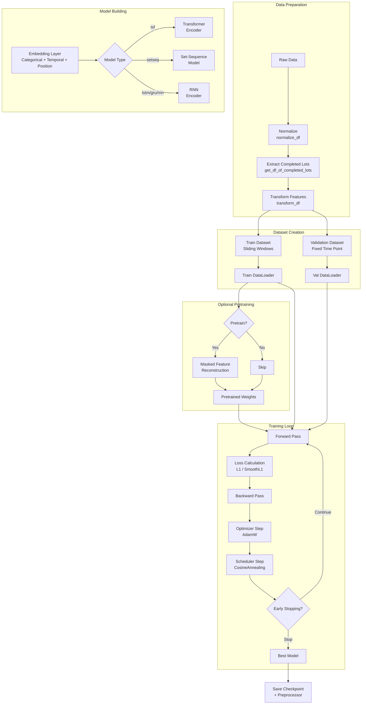
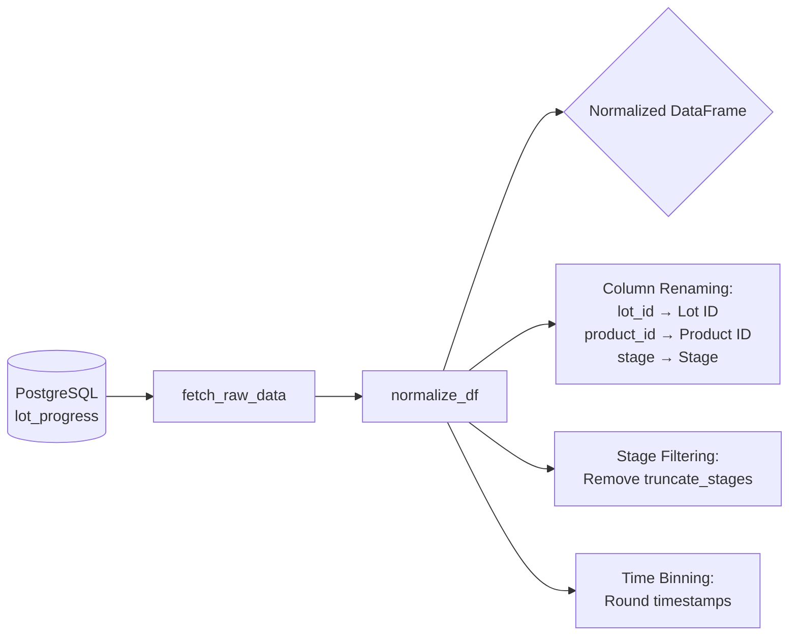

# WIP Prediction Model Training Pipeline

## Overview

End-to-end training pipeline for time-series deep learning models that predict lot completion times (lead time) in semiconductor manufacturing. Supports Transformer, LSTM/GRU/RNN, and Set-Sequence models with optional self-supervised pretraining.

## Quick Start

### Basic Training
```bash
cd scripts/training
python train.py
```

### Custom Configuration
```python
import yaml
from train import train

# Load configurations
with open("config/pred_template/core_template.yaml") as f:
    core_config = yaml.safe_load(f)

with open("config/pred_template/train_template.yaml") as f:
    train_config = yaml.safe_load(f)

# Train model
model, preprocessor = train(
    core_config=core_config,
    train_config=train_config,
    pretrain_config=None,  # Optional pretraining
    plot=False
)
```

## Architecture Overview



## Configuration Files

### 1. Core Configuration (`core_template.yaml`)

Defines data, dataset, embeddings, and model architecture.

#### Data Section
```yaml
data:
  dates:
    train_end: '2024-08-31'    # Training data cutoff
    val_end: '2024-10-31'       # Validation data cutoff (optional)
```

**Purpose**: Define temporal split for train/validation

#### Dataset Section
```yaml
dataset:
  type: 'lotwise'  # Options: 'fabwise' or 'lotwise'
  params:
    window_days: 15   # Sliding window length (days)
    step_days: 7      # Sliding window step size (days)
    # random_sampling: true     # Enable random window sampling
    # random_sample_num: 70     # Number of random samples
```

**Dataset Types**:

| Type | Description | Use Case |
|------|-------------|----------|
| `fabwise` | Entire fab state at each time point | Predict all lots simultaneously |
| `lotwise` | Individual lot sequences | Predict one lot at a time |

**Key Parameters**:
- `window_days`: Historical context length
  - Larger → More context, slower training
  - Smaller → Less context, faster training
  - Typical: 15-30 days

- `step_days`: Training sample density
  - Smaller → More samples, longer training
  - Larger → Fewer samples, faster training
  - Typical: 3-7 days

**Sliding Window Illustration**:
```
Timeline: |-------|-------|-------|-------|-------|
          Day 0   Day 7   Day 14  Day 21  Day 28

window_days=15, step_days=7:

Window 1: |=====window=====|
          Day 0            Day 15

Window 2:         |=====window=====|
                  Day 7            Day 22

Window 3:                 |=====window=====|
                          Day 14           Day 29
```

#### Embedding Section
```yaml
embed:
  numeric_feat_cols: ['Wafer Qty']  # Numerical features
  
  categorical_feat_cols:  # Categorical features with encoding
    - name: 'Product ID'
      encoder: 'embed'    # 'embed' or 'onehot'
      dim: 16             # Embedding dimension
    - name: 'Stage'
      encoder: 'embed'
      dim: 64
    - name: 'Lot Status'
      encoder: 'embed'
      dim: 2
  
  temporal_feat_cols: ['year', 'month', 'day', 'weekday']
  # Options: any subset of ['year', 'month', 'day', 'weekday', 'hour', 'minute']
  
  temporal_embed_dim: 32   # Temporal embedding dimension
  
  position_col: '_datetime'  # Timestamp column
  pos_enc: t2v              # Position encoding: 't2v', 'abs', 'fixed', or null
  
  use_given_emb: true       # Use "is_given" feature (actual vs interpolated)
```

**Embedding Strategies**:

1. **Learnable Embedding** (`encoder: 'embed'`):
   - Creates dense vector representation
   - Captures semantic similarity
   - Good for high-cardinality features (Product ID, Stage)
   - Dimension guidelines: `dim ≈ min(50, num_categories/2)`

2. **One-Hot Encoding** (`encoder: 'onehot'`):
   - Sparse binary representation
   - No learned relationships
   - Good for low-cardinality features (Lot Status)

**Position Encoding Methods**:

| Method | Description | Best For |
|--------|-------------|----------|
| `t2v` | Time2Vec - learnable periodic encoding | Irregular time series |
| `abs` | Absolute positional encoding (Transformer-style) | Regular sequences |
| `fixed` | Fixed sinusoidal encoding | Regular sequences |
| `null` | No position encoding | Order-invariant models |

#### Model Section
```yaml
model:
  type: 'tsf'  # Options: 'tsf', 'setseq', 'lstm', 'gru', 'rnn'
  params:
    d_phi: 32          # Summary feature dimension
    d_summary: 16      # Summary projection dimension
    d_model: 128       # Model hidden dimension
    n_head: 8          # Number of attention heads (Transformer only)
    n_layers: 2        # Number of encoder layers
    d_ff: 256          # Feedforward dimension
    dropout: 0.2       # Dropout rate
    agg: 'last'        # Aggregation: 'last', 'mean', 'max'
    norm: 'BatchNorm'  # Normalization: 'BatchNorm' or 'LayerNorm'
```

**Model Types**:

1. **Transformer (`tsf`)**:
   - Self-attention mechanism
   - Captures long-range dependencies
   - Best for: Complex patterns, variable-length sequences
   - Parameters: `n_head`, `n_layers`, `d_ff`

2. **Set-Sequence (`setseq`)**:
   - Hybrid attention + set encoding
   - Handles permutation-invariant features
   - Best for: Fab-level predictions with set inputs

3. **RNN Variants (`lstm`, `gru`, `rnn`)**:
   - Sequential processing
   - Lower memory footprint
   - Best for: Long sequences, limited compute

**Architecture Decisions**:

| Scenario | Recommended Type | Key Params |
|----------|------------------|------------|
| Short sequences (<50 steps) | `tsf` | `n_layers=2-3`, `n_head=4-8` |
| Long sequences (>100 steps) | `lstm`/`gru` | `n_layers=2-4` |
| Fab-level (many lots) | `setseq` | `d_phi=32`, `d_summary=16` |
| Limited GPU memory | `gru` | `d_model=64-128` |
| Maximum accuracy | `tsf` | `d_model=256`, `n_layers=4` |

### 2. Training Configuration (`train_template.yaml`)

Defines training hyperparameters and optimization settings.

```yaml
training:
  batch_size: 128         # Batch size for training
  epochs: 80              # Maximum training epochs
  seed: 42                # Random seed for reproducibility
  save_dir: "checkpoints" # Model checkpoint directory
  log_dir: "experiments"  # TensorBoard logs directory

loss:
  type: "L1Loss"  # Options: 'L1Loss' or 'SmoothL1Loss'

optimizer:
  type: "AdamW"   # Optimizer type
  params:
    lr: 0.006           # Learning rate
    weight_decay: 0.00015  # L2 regularization

scheduler:
  type: "CosineAnnealingWarmRestarts"
  warmup_epoch: 10    # Warmup epochs
  params:
    T_0: 10           # Initial restart period
    T_mult: 2         # Period multiplier
    eta_min: 0.0000001  # Minimum learning rate

early_stopping:
  monitor: "val_MAE"  # Metric to monitor
  patience: 30        # Epochs without improvement
  min_delta: 0        # Minimum change to qualify as improvement
```

**Loss Functions**:

| Loss | Formula | Best For |
|------|---------|----------|
| `L1Loss` | $\|\|y - \hat{y}\|\|_1$ | Robust to outliers |
| `SmoothL1Loss` | Huber loss | Balance between L1 and L2 |

**Scheduler Strategies**:

1. **CosineAnnealingWarmRestarts**:
   - Periodic restarts help escape local minima
   - `T_mult=2`: Restart periods double each time
   
2. **CosineAnnealingLR** (alternative):
   - Smooth decay without restarts

### 3. Pretraining Configuration (`pretrain_template.yaml`)

Optional self-supervised pretraining via masked feature reconstruction.

```yaml
dataset:
  extra_params:
    noise_cols: ['Stage']  # Features to mask
    noise_ratio: 0.2       # Fraction of features to mask

pretraining:
  epochs: 100

optimizer:
  type: "AdamW"
  params:
    lr: 0.0003
    weight_decay: 0.01

scheduler:
  type: "CosineAnnealingLR"
  warmup_epoch: 10
  params:
    T_max: 90
```

**Pretraining Mechanism**:
```
Original:  [Stage=DIFF] [Stage=LITHO] [Stage=ETCH] [Stage=CLEAN]

Masked:    [Stage=DIFF] [Stage=MASK]  [Stage=ETCH] [Stage=MASK]
           (20% masked)

Task:      Reconstruct masked features from context
```

**Benefits**:
- Better feature representations
- Improved convergence speed
- Useful when labeled data is limited
- Typical improvement: 2-5% MAE reduction

## Data Flow Pipeline

### Stage 1: Data Loading & Normalization



**Function**: `normalize_df()`

**Input Columns** (raw data):
```
lot_id | parent_lot_id | product_id | stage | lot_status | current_wafer_qty | created_at
-------|---------------|------------|-------|------------|-------------------|------------
LOT001 | PARENT001     | HB123      | DIFF  | ACTIVE     | 300               | 2024-01-01 08:05:23
LOT001 | PARENT001     | HB123      | LITHO | ACTIVE     | 300               | 2024-01-02 10:15:47
```

**Output Columns** (normalized):
```
Lot ID | Parent Lot ID | Product ID | Stage | Lot Status | Wafer Qty | _datetime
-------|---------------|------------|-------|------------|-----------|-------------------
LOT001 | PARENT001     | HB123      | DIFF  | ACTIVE     | 300       | 2024-01-01 08:00:00
LOT001 | PARENT001     | HB123      | LITHO | ACTIVE     | 300       | 2024-01-02 10:00:00
```

**Normalization Steps**:
1. Column renaming to standard format
2. Stage filtering (remove `truncate_stages`)
3. Time binning to nearest hour (optional)
4. Duplicate removal
5. Sorting by `Lot ID` and `_datetime`

### Stage 2: Completed Lots Extraction

**Function**: `get_df_of_completed_lots(df)`

**Purpose**: Identify lots with known completion times (labels)

**Algorithm**:
```python
for each lot:
    start_time = min(_datetime)
    end_time = max(_datetime)
    LT = (end_time - start_time).days  # Lead time in days
    
    if lot_has_terminal_stage:
        completed_lots.append({
            'Lot ID': lot_id,
            'Product ID': product_id,
            'start_time': start_time,
            'end_time': end_time,
            'LT': LT
        })
```

**Output DataFrame**:
```
Index (Lot ID) | Product ID | start_time          | end_time            | LT (days)
---------------|------------|---------------------|---------------------|----------
LOT001         | HB123      | 2024-01-01 08:00:00 | 2024-01-25 16:00:00 | 24.33
LOT002         | HB123      | 2024-01-02 09:00:00 | 2024-01-28 14:00:00 | 26.21
LOT003         | HB456      | 2024-01-03 10:00:00 | 2024-02-05 12:00:00 | 33.08
```

### Stage 3: Feature Transformation

**Function**: `transform_df(df, embed_config, split_time=None, preprocessor=None)`

**Purpose**: Encode categorical features and extract temporal features

**Steps**:

1. **Fit Preprocessor** (if not provided):
   ```python
   from sklearn.preprocessing import LabelEncoder
   
   preprocessor = {
       'Product ID': LabelEncoder().fit(df['Product ID']),
       'Stage': LabelEncoder().fit(df['Stage']),
       'Lot Status': LabelEncoder().fit(df['Lot Status'])
   }
   ```

2. **Transform Categories**:
   ```python
   df['Product ID'] = preprocessor['Product ID'].transform(df['Product ID'])
   df['Stage'] = preprocessor['Stage'].transform(df['Stage'])
   # Product ID: "HB123" → 0, "HB456" → 1
   # Stage: "DIFF" → 0, "LITHO" → 1, "ETCH" → 2
   ```

3. **Extract Temporal Features**:
   ```python
   df['year'] = df['_datetime'].dt.year
   df['month'] = df['_datetime'].dt.month
   df['day'] = df['_datetime'].dt.day
   df['weekday'] = df['_datetime'].dt.weekday
   ```

4. **Add is_given Flag**:
   ```python
   # Flag for actual vs interpolated records
   df['is_given'] = 1  # or based on stage_type
   ```

### Stage 4: Dataset Creation

#### Train Dataset: Sliding Windows

**Function**: `get_train_dataset(df, df_of_completed_lots, core_config)`

**Strategy**: Create multiple training samples per lot using sliding windows

**Window Generation**:
```python
window_days = 15
step_days = 7
train_end = '2024-08-31'

for lot_id in completed_lots:
    lot_start = df_of_completed_lots.loc[lot_id, 'start_time']
    lot_end = df_of_completed_lots.loc[lot_id, 'end_time']
    
    # Prediction window: from lot_start to (lot_end - 1 day)
    # This ensures we predict at least 1 day before completion
    min_pred_time = lot_start
    max_pred_time = lot_end - timedelta(days=1)
    
    # Generate windows
    for pred_time in range(min_pred_time, max_pred_time, step_days):
        window_start = pred_time - timedelta(days=window_days)
        window_end = pred_time
        
        # Get data in window
        window_data = df[(df['Lot ID'] == lot_id) & 
                        (df['_datetime'] > window_start) &
                        (df['_datetime'] <= window_end)]
        
        # Label: days until lot completes
        label = (lot_end - pred_time).days
        
        samples.append((window_data, label))
```

**Example**:
```
Lot LOT001: start=2024-01-01, end=2024-01-25 (LT=24 days)

window_days=15, step_days=7:

Sample 1: pred_time=2024-01-08
  - Window: 2023-12-24 to 2024-01-08 (15 days)
  - Label: 17 days (2024-01-25 - 2024-01-08)

Sample 2: pred_time=2024-01-15
  - Window: 2024-01-01 to 2024-01-15 (15 days)
  - Label: 10 days (2024-01-25 - 2024-01-15)

Sample 3: pred_time=2024-01-22
  - Window: 2024-01-08 to 2024-01-22 (15 days)
  - Label: 3 days (2024-01-25 - 2024-01-22)
```

#### Validation Dataset: Fixed Time Points

**Function**: `get_val_dataset(df, df_of_completed_lots, core_config, val_start, val_end)`

**Strategy**: Predict at 1/3 lead time for consistency

```python
for lot_id in completed_lots:
    if lot_end > val_start:  # Lot completes during validation period
        LT = df_of_completed_lots.loc[lot_id, 'LT']
        
        # Predict at 1/3 of lead time
        pred_time = lot_start + timedelta(days=LT * 1/3)
        
        # Narrow window for consistent evaluation
        min_pred_time = pred_time
        max_pred_time = pred_time + timedelta(days=1)
        
        window_start = pred_time - timedelta(days=window_days)
        window_end = pred_time
        
        window_data = df[(df['Lot ID'] == lot_id) & 
                        (df['_datetime'] > window_start) &
                        (df['_datetime'] <= window_end)]
        
        label = (lot_end - pred_time).days
        
        val_samples.append((window_data, label))
```

**Rationale**: Predicting at 1/3 LT provides:
- Sufficient historical context
- Meaningful remaining time to predict
- Consistent evaluation across lots

### Stage 5: DataLoader Creation

**Purpose**: Batch samples for efficient GPU training

```python
train_loader = train_dataset.to_dataloader(
    batch_size=128,
    shuffle=True,
    num_workers=0
)

val_loader = val_dataset.to_dataloader(
    batch_size=128,
    shuffle=False,
    num_workers=0
)
```

**Batch Structure**:
```python
batch = {
    'seqs_with_label': [
        {
            'Product ID': tensor([0, 0, 0, ...]),      # Shape: (seq_len,)
            'Stage': tensor([0, 1, 2, ...]),
            'Lot Status': tensor([1, 1, 1, ...]),
            'Wafer Qty': tensor([300, 300, 295, ...]), # Numeric features
            'year': tensor([2024, 2024, ...]),         # Temporal features
            'month': tensor([1, 1, ...]),
            'day': tensor([5, 6, ...]),
            'weekday': tensor([4, 5, ...]),
            '_datetime': tensor([...]),                # Position
            'is_given': tensor([1, 1, 1, ...]),        # Mask
            'label': tensor(17.5),                     # Target: days until completion
            'lot_id': 'LOT001'
        },
        # ... more sequences in batch
    ],
    'seqs_without_label': [...]  # For fab-level datasets
}
```

## Model Architecture

### Embedding Layer

**Class**: `Embedding`

**Purpose**: Convert raw features to dense vector representations

```python
class Embedding:
    def __init__(self, d_model, **embed_config):
        # Categorical embeddings
        self.product_embed = nn.Embedding(num_products, dim_product)
        self.stage_embed = nn.Embedding(num_stages, dim_stage)
        self.status_embed = nn.Embedding(num_statuses, dim_status)
        
        # Temporal embeddings
        self.year_embed = nn.Embedding(num_years, temporal_embed_dim)
        self.month_embed = nn.Embedding(12, temporal_embed_dim)
        self.day_embed = nn.Embedding(31, temporal_embed_dim)
        self.weekday_embed = nn.Embedding(7, temporal_embed_dim)
        
        # Position encoding
        if pos_enc == 't2v':
            self.pos_encoder = Time2Vec(d_model)
        elif pos_enc == 'abs':
            self.pos_encoder = AbsolutePositionalEncoding(d_model)
        
        # is_given embedding
        if use_given_emb:
            self.given_embed = nn.Embedding(2, d_model)
        
        # Project concatenated embeddings to d_model
        self.projection = nn.Linear(total_dim, d_model)
    
    def forward(self, x):
        # Concatenate all embeddings
        cat_embeds = torch.cat([
            self.product_embed(x['Product ID']),
            self.stage_embed(x['Stage']),
            self.status_embed(x['Lot Status']),
            self.year_embed(x['year']),
            self.month_embed(x['month']),
            # ... other features
            x['Wafer Qty'].unsqueeze(-1)  # Numeric features
        ], dim=-1)
        
        # Project to d_model
        embed = self.projection(cat_embeds)
        
        # Add position encoding
        if self.pos_encoder:
            embed = embed + self.pos_encoder(x['_datetime'])
        
        # Add is_given embedding
        if self.use_given_emb:
            embed = embed + self.given_embed(x['is_given'])
        
        return embed  # Shape: (batch, seq_len, d_model)
```

### Transformer Model (`tsf`)

**Class**: `TSTransformerEncoderRegressor`

```python
class TSTransformerEncoderRegressor:
    def __init__(self, embedding, d_model, n_head, n_layers, d_ff, dropout, agg, norm):
        self.embedding = embedding
        
        # Transformer encoder
        encoder_layer = nn.TransformerEncoderLayer(
            d_model=d_model,
            nhead=n_head,
            dim_feedforward=d_ff,
            dropout=dropout,
            batch_first=True,
            norm_first=(norm == 'LayerNorm')
        )
        self.encoder = nn.TransformerEncoder(encoder_layer, num_layers=n_layers)
        
        # Aggregation
        self.agg = agg  # 'last', 'mean', or 'max'
        
        # Regression head
        self.regressor = nn.Linear(d_model, 1)
    
    def forward(self, x, mask):
        # Embed inputs
        embed = self.embedding(x)  # (batch, seq_len, d_model)
        
        # Encode
        encoded = self.encoder(embed, src_key_padding_mask=~mask)
        
        # Aggregate
        if self.agg == 'last':
            summary = encoded[:, -1, :]  # Last time step
        elif self.agg == 'mean':
            summary = encoded.mean(dim=1)  # Average pooling
        elif self.agg == 'max':
            summary = encoded.max(dim=1)[0]  # Max pooling
        
        # Predict
        output = self.regressor(summary).squeeze(-1)  # (batch,)
        
        return output
```

**Forward Pass Example**:
```
Input sequence (seq_len=20):
  Product ID: [0, 0, 0, ...]
  Stage:      [0, 1, 2, ...]
  ...

↓ Embedding (d_model=128)
  (batch=32, seq_len=20, d_model=128)

↓ Transformer Encoder (n_layers=2, n_head=8)
  Multi-head self-attention
  → Captures dependencies between time steps

↓ Aggregation ('last')
  summary = encoded[:, -1, :]
  (batch=32, d_model=128)

↓ Regression Head
  output = Linear(128 → 1)
  (batch=32,)

↓ Denormalize
  pred_days = output * (max_target - min_target) + min_target
```

### RNN Models (`lstm`, `gru`, `rnn`)

**Class**: `TSRNNEncoderRegressor`

```python
class TSRNNEncoderRegressor:
    def __init__(self, embedding, d_model, n_layers, dropout, agg, model_type):
        self.embedding = embedding
        
        # RNN encoder
        if model_type == 'lstm':
            self.encoder = nn.LSTM(d_model, d_model, n_layers, 
                                   dropout=dropout, batch_first=True)
        elif model_type == 'gru':
            self.encoder = nn.GRU(d_model, d_model, n_layers,
                                  dropout=dropout, batch_first=True)
        elif model_type == 'rnn':
            self.encoder = nn.RNN(d_model, d_model, n_layers,
                                  dropout=dropout, batch_first=True)
        
        self.agg = agg
        self.regressor = nn.Linear(d_model, 1)
    
    def forward(self, x, mask):
        embed = self.embedding(x)
        
        # Encode
        encoded, _ = self.encoder(embed)  # (batch, seq_len, d_model)
        
        # Aggregate
        if self.agg == 'last':
            summary = encoded[:, -1, :]
        elif self.agg == 'mean':
            summary = encoded.mean(dim=1)
        
        output = self.regressor(summary).squeeze(-1)
        return output
```

## Training Process

### Training Loop

**Class**: `RegTrainer`

```python
class RegTrainer:
    def __init__(self, model, criterion, optimizer, scheduler, metrics, 
                 target_scaler, device, log_dir, save_dir, early_stopping):
        self.model = model.to(device)
        self.criterion = criterion
        self.optimizer = optimizer
        self.scheduler = scheduler
        self.metrics = metrics  # {'MAE': mean_absolute_error}
        self.min_target, self.max_target = target_scaler
        self.device = device
        self.early_stopping = early_stopping
    
    def run(self, train_loader, val_loader, n_epoch, 
            collect_train_details=True, collect_val_details=True):
        
        for epoch in range(n_epoch):
            # Training
            train_loss, train_metrics = self.train_epoch(train_loader)
            
            # Validation
            val_loss, val_metrics = self.validate(val_loader)
            
            # Scheduler step
            self.scheduler.step()
            
            # Logging
            print(f"Epoch {epoch}: "
                  f"train_loss={train_loss:.4f}, train_MAE={train_metrics['MAE']:.4f}, "
                  f"val_loss={val_loss:.4f}, val_MAE={val_metrics['MAE']:.4f}")
            
            # Early stopping
            if self.early_stopping:
                self.early_stopping(val_metrics['MAE'], self.model)
                if self.early_stopping.early_stop:
                    print(f"Early stopping at epoch {epoch}")
                    break
        
        # Load best weights
        self.model.load_state_dict(self.early_stopping.best_model_weights)
    
    def train_epoch(self, train_loader):
        self.model.train()
        total_loss = 0
        all_preds = []
        all_targets = []
        
        for batch in train_loader:
            # Forward
            preds = self.model(batch['seqs_with_label'], mask=...)
            
            # Normalize targets
            targets = batch['labels']
            targets_norm = (targets - self.min_target) / (self.max_target - self.min_target)
            
            # Loss
            loss = self.criterion(preds, targets_norm).mean()
            
            # Backward
            self.optimizer.zero_grad()
            loss.backward()
            self.optimizer.step()
            
            # Denormalize for metrics
            preds_denorm = preds * (self.max_target - self.min_target) + self.min_target
            all_preds.extend(preds_denorm.cpu().detach().numpy())
            all_targets.extend(targets.cpu().numpy())
            
            total_loss += loss.item()
        
        # Calculate metrics
        train_mae = self.metrics['MAE'](all_targets, all_preds)
        
        return total_loss / len(train_loader), {'MAE': train_mae}
```

### Early Stopping

**Class**: `EarlyStopping`

```python
class EarlyStopping:
    def __init__(self, monitor, patience, min_delta, path):
        self.monitor = monitor  # 'val_MAE'
        self.patience = patience
        self.min_delta = min_delta
        self.path = path
        
        self.best_score = float('inf')
        self.counter = 0
        self.early_stop = False
        self.best_model_weights = None
    
    def __call__(self, current_score, model):
        if current_score < self.best_score - self.min_delta:
            # Improvement
            self.best_score = current_score
            self.best_model_weights = model.state_dict()
            self.counter = 0
            
            # Save checkpoint
            if self.path:
                torch.save(model.state_dict(), self.path)
        else:
            # No improvement
            self.counter += 1
            if self.counter >= self.patience:
                self.early_stop = True
```

### Optional Pretraining

**Purpose**: Learn better feature representations via self-supervised task

**Task**: Masked feature reconstruction

```python
def pretrain(train_dataset, core_config, pretrain_config, device):
    # Create pretraining dataloader
    noise_cols = pretrain_config['dataset']['extra_params']['noise_cols']
    noise_ratio = pretrain_config['dataset']['extra_params']['noise_ratio']
    
    pretrain_loader = train_dataset.to_dataloader(
        superv=False,  # Unsupervised mode
        noise_cols=noise_cols,
        noise_ratio=noise_ratio
    )
    
    # Build encoder-only model
    model = TSTransformerEncoder(...)  # No regression head
    
    # Training loop
    for epoch in range(pretrain_config['pretraining']['epochs']):
        for batch in pretrain_loader:
            # Mask random features
            masked_batch, targets = apply_noise_mask(batch, noise_cols, noise_ratio)
            
            # Predict masked features
            preds = model(masked_batch)
            
            # Loss: cross-entropy for categorical features
            loss = nn.CrossEntropyLoss()(preds, targets)
            
            # Backward
            optimizer.zero_grad()
            loss.backward()
            optimizer.step()
    
    # Return pretrained weights for main training
    return model.state_dict()
```

**Masking Strategy**:
```
Original sequence:
  Stage: [DIFF, LITHO, ETCH, CLEAN, MEASURE]

Masked sequence (20% noise):
  Stage: [DIFF, [MASK], ETCH, [MASK], MEASURE]

Model task: Predict LITHO and CLEAN from context
```

## Output & Checkpointing

### Directory Structure
```
checkpoints/
  20251113_235404/          # Timestamp folder
    best_model.pth          # Best model weights
    config.yaml             # Core configuration
    preprocessor.pkl        # Feature encoders

experiments/
  20251113_235404/          # TensorBoard logs
    config.yaml             # Training configuration
    tb_logs/                # TensorBoard event files
      events.out.tfevents.*
```

### Saved Objects

#### 1. Model Checkpoint (`best_model.pth`)
```python
state_dict = {
    'embedding.product_embed.weight': tensor(...),
    'embedding.stage_embed.weight': tensor(...),
    'encoder.layers.0.self_attn.in_proj_weight': tensor(...),
    # ... all model parameters
}
```

#### 2. Preprocessor (`preprocessor.pkl`)
```python
preprocessor = {
    'Product ID': LabelEncoder(classes=['HB123', 'HB456', ...]),
    'Stage': LabelEncoder(classes=['DIFF', 'LITHO', 'ETCH', ...]),
    'Lot Status': LabelEncoder(classes=['ACTIVE', 'HOLD', ...]),
    # ... other encoders
}
```

**Usage for Inference**:
```python
import pickle
import torch

# Load preprocessor
with open('checkpoints/20251113_235404/preprocessor.pkl', 'rb') as f:
    preprocessor = pickle.load(f)

# Load model
model = build_model(core_config)
model.load_state_dict(torch.load('checkpoints/20251113_235404/best_model.pth'))
model.eval()

# Preprocess new data
new_df = transform_df(raw_df, embed_config, preprocessor=preprocessor)

# Predict
predictions = model(new_df)
```

## Performance Tuning

### Hyperparameter Guidelines

| Scenario | Batch Size | Learning Rate | Epochs | window_days |
|----------|------------|---------------|--------|-------------|
| Small dataset (<10k samples) | 32-64 | 0.001-0.003 | 100-200 | 15-30 |
| Medium dataset (10k-100k) | 128-256 | 0.003-0.01 | 50-100 | 15-30 |
| Large dataset (>100k) | 256-512 | 0.01-0.03 | 30-80 | 30-60 |
| Limited GPU memory | 32-64 | 0.001 | 100+ | 15 |
| Fast prototyping | 128 | 0.01 | 20-30 | 7-15 |

### Common Issues & Solutions

| Issue | Symptom | Solution |
|-------|---------|----------|
| Overfitting | val_MAE >> train_MAE | Increase dropout, add weight decay, reduce model size |
| Underfitting | train_MAE high | Increase model capacity (d_model, n_layers), reduce dropout |
| Slow convergence | Loss plateaus early | Increase learning rate, add warmup, check data quality |
| NaN loss | Loss becomes NaN | Reduce learning rate, add gradient clipping, check target normalization |
| OOM error | CUDA out of memory | Reduce batch_size, reduce d_model, reduce window_days |

## Complete Training Example

```python
import yaml
from train import train

# Load configurations
with open("config/pred_template/core_template.yaml") as f:
    core_config = yaml.safe_load(f)

with open("config/pred_template/train_template.yaml") as f:
    train_config = yaml.safe_load(f)

with open("config/pred_template/pretrain_template.yaml") as f:
    pretrain_config = yaml.safe_load(f)

# Customize configurations
core_config['dataset']['params']['window_days'] = 21  # Increase context
core_config['model']['params']['d_model'] = 256       # Larger model
train_config['training']['batch_size'] = 64          # Smaller batch
train_config['training']['epochs'] = 100             # More epochs

# Train with pretraining
model, preprocessor = train(
    core_config=core_config,
    train_config=train_config,
    pretrain_config=pretrain_config,  # Enable pretraining
    plot=False,  # Disable visualization
    print_normalize_details=True
)

# Model and preprocessor are saved to:
# - checkpoints/YYYYMMDD_HHMMSS/best_model.pth
# - checkpoints/YYYYMMDD_HHMMSS/preprocessor.pkl
```

## Related Documentation

- [06-lot-quickest-finish.md](./06-lot-quickest-finish.md) - Uses trained model for predictions
- [01-lot-level-hwm.md](./01-lot-level-hwm.md) - Input data format
- [02-product-level-hwm.md](./02-product-level-hwm.md) - Product-level features
