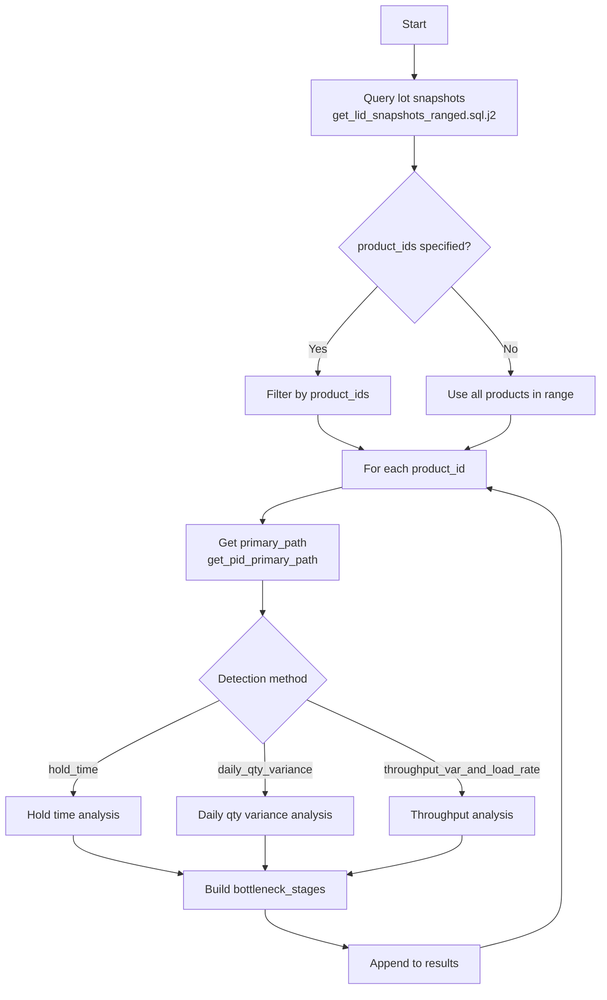
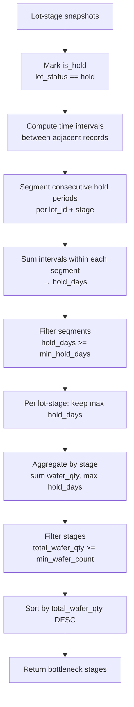
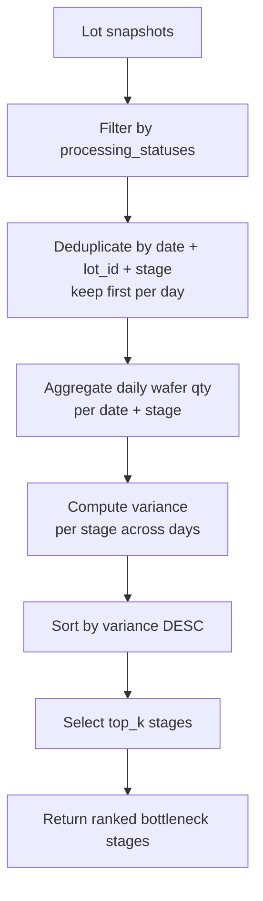
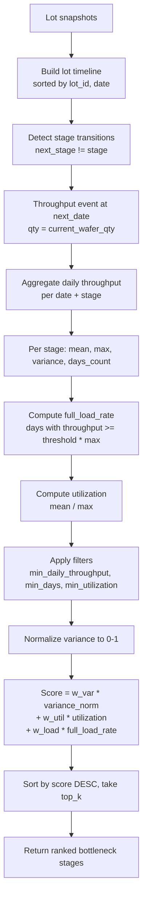

# Bottleneck Stage Detection

## Overview

Identifies potential bottleneck stages in semiconductor manufacturing by analyzing lot snapshot data within a time window. Three detection methods are supported:

1. **Hold Time** (`hold_time`): Stages where many wafers remain in Hold status for consecutive days.
2. **Daily Quantity Variance** (`daily_qty_variance`): Stages with the highest variance in daily processing wafer quantity.
3. **Throughput Variance & Load Rate** (`throughput_var_and_load_rate`): Stages with high daily throughput variance combined with utilization and full-load rate.

All methods query snapshot data in `[start_time, end_time]`, analyze each product independently, and attach the product's primary process route via `get_pid_primary_path`.

**Location**: `wip_analysis/bottleneck/bottle_neck_detection.py`

## API Endpoint

```http
POST /api/v1/bottleneck_detection
```

### Request Body

```json
{
    "start_time": "2024-01-01T00:00:00",
    "end_time": "2024-01-31T23:59:59",
    "product_ids": ["HB123"],
    "method": "hold_time",
    "rules": {
        "min_wafer_count": 10,
        "min_hold_days": 3
    }
}
```

| Field | Type | Required | Description |
|-------|------|----------|-------------|
| `start_time` | datetime | Yes | Analysis window start (must be before `end_time`) |
| `end_time` | datetime | Yes | Analysis window end |
| `product_ids` | list[str] \| null | No | Products to analyze; `null` = all products in range |
| `method` | string | Yes | One of `hold_time`, `daily_qty_variance`, `throughput_var_and_load_rate` |
| `rules` | object | No | Method-specific parameter overrides (see below) |

### Supported Methods and Rules

#### `hold_time`

Detects stages where wafers accumulate in Hold status for consecutive days.

| Rule | Default | Description |
|------|---------|-------------|
| `min_wafer_count` | 10 | Minimum total wafer count in hold at a stage |
| `min_hold_days` | 3 | Minimum consecutive hold days per lot-stage segment |

```json
{
    "method": "hold_time",
    "rules": {
        "min_wafer_count": 10,
        "min_hold_days": 3
    }
}
```

#### `daily_qty_variance`

Ranks stages by variance of daily processing wafer quantity.

| Rule | Default | Description |
|------|---------|-------------|
| `processing_statuses` | `["Active"]` | Lot statuses treated as "processing" (e.g. `["Active", "Bank"]`) |
| `top_k` | 5 | Number of top-variance stages to return |

```json
{
    "method": "daily_qty_variance",
    "rules": {
        "processing_statuses": ["Active"],
        "top_k": 5
    }
}
```

#### `throughput_var_and_load_rate`

Scores stages using throughput variance, utilization, and full-load rate, then returns top K.

| Rule | Default | Description |
|------|---------|-------------|
| `top_k` | 5 | Number of top-scoring stages to return |
| `min_daily_throughput` | 1 | Minimum max daily throughput for a stage to qualify |
| `min_days` | 5 | Minimum number of days with throughput records |
| `min_utilization` | 0.5 | Minimum average utilization (mean / max daily throughput) |
| `full_load_threshold` | 0.85 | Fraction of max throughput used to judge a day as "full load" |
| `weight_variance` | 0.5 | Weight of normalized throughput variance in final score |
| `weight_utilization` | 0.25 | Weight of utilization in final score |
| `weight_full_load` | 0.25 | Weight of full load rate in final score |

```json
{
    "method": "throughput_var_and_load_rate",
    "rules": {
        "top_k": 5,
        "min_daily_throughput": 1,
        "min_days": 5,
        "min_utilization": 0.5,
        "full_load_threshold": 0.85,
        "weight_variance": 0.5,
        "weight_utilization": 0.25,
        "weight_full_load": 0.25
    }
}
```

### Response Shape

```json
[
    {
        "product_id": "HB123",
        "primary_path": ["DIFF", "LITHO", "ETCH"],
        "bottleneck_stages": [
            {
                "stage": "ETCH",
                "reason": "15 wafers at stage ETCH consecutively held for 5.2 days"
            }
        ]
    }
]
```

Returns HTTP 404 when no bottleneck results are found for the given filters and method.

## Core Functions

### `detect_bottleneck_by_hold_time`

```python
def detect_bottleneck_by_hold_time(
    start_time: datetime,
    end_time: datetime,
    product_ids: Optional[list[str]] = None,
    min_wafer_count: int = 10,
    min_hold_days: int = 3,
) -> list[dict[str, Any]]
```

For each product, flags stages where the total wafer count in Hold status reaches `min_wafer_count`, and at least one lot has a consecutive hold segment of at least `min_hold_days`.

**Reason format**: `"{total_wafer_qty} wafers at stage {stage} consecutively held for {max_hold_days} days"`

### `detect_bottleneck_by_daily_qty_variance`

```python
def detect_bottleneck_by_daily_qty_variance(
    start_time: datetime,
    end_time: datetime,
    product_ids: Optional[list[str]] = None,
    processing_statuses: list[str] = ["Active"],
    top_k: int = 5,
) -> list[dict[str, Any]]
```

For each product, computes daily processing wafer quantity per stage (deduplicated by date + lot + stage), calculates variance across days, and returns the top K stages with highest variance.

**Reason format**: `"Ranked #{rank} in processing quantity variance (variance={variance:.2f})"`

### `detect_bottleneck_by_throughput_var_and_load_rate`

```python
def detect_bottleneck_by_throughput_var_and_load_rate(
    start_time: datetime,
    end_time: datetime,
    product_ids: Optional[list[str]] = None,
    top_k: int = 5,
    min_daily_throughput: int = 1,
    min_days: int = 5,
    min_utilization: float = 0.5,
    full_load_threshold: float = 0.85,
    weight_variance: float = 0.5,
    weight_utilization: float = 0.25,
    weight_full_load: float = 0.25,
) -> list[dict[str, Any]]
```

For each product, derives lot-level throughput events (stage change), aggregates daily throughput per stage, computes statistics, applies filters, and ranks by a weighted bottleneck score.

**Reason format**: includes score, mean/max daily throughput, variance, utilization, and full load rate.

### Example Usage

```python
from datetime import datetime
from wip_analysis.bottleneck.bottle_neck_detection import (
    detect_bottleneck_by_hold_time,
    detect_bottleneck_by_daily_qty_variance,
    detect_bottleneck_by_throughput_var_and_load_rate,
)

start = datetime(2024, 1, 1)
end = datetime(2024, 1, 31)

# Method 1: Hold time
hold_results = detect_bottleneck_by_hold_time(
    start_time=start,
    end_time=end,
    product_ids=["HB123"],
    min_wafer_count=10,
    min_hold_days=3,
)

# Method 2: Daily quantity variance
variance_results = detect_bottleneck_by_daily_qty_variance(
    start_time=start,
    end_time=end,
    product_ids=["HB123"],
    processing_statuses=["Active"],
    top_k=5,
)

# Method 3: Throughput variance and load rate
throughput_results = detect_bottleneck_by_throughput_var_and_load_rate(
    start_time=start,
    end_time=end,
    product_ids=["HB123"],
    top_k=5,
)
```

## Processing Logic

### Common Data Pipeline

All three methods share the same initial steps:



### Method 1: Hold Time



**Hold segment logic**:

- Records are grouped by `(lot_id, stage)` and sorted by timestamp.
- A new hold segment starts when the previous record was not in Hold (or there is no previous record).
- Only intervals between **adjacent Hold records** are counted toward hold time.
- For each lot-stage, only the longest hold segment is kept.
- Stage-level aggregation sums wafer quantities across qualifying lots and tracks the maximum hold days.

### Method 2: Daily Quantity Variance



**Daily quantity definition**:

- Each lot is counted at most once per day at each stage (first snapshot of the day).
- Daily wafer quantity = sum of `current_wafer_qty` for all lots at that stage on that date.
- Variance is computed across all days in the analysis window.

### Method 3: Throughput Variance & Load Rate



**Throughput definition**:

- A throughput event occurs when a lot's next snapshot is at a **different stage**.
- The event is attributed to the **previous stage** at the **next snapshot's date**.
- Throughput quantity = `current_wafer_qty` at the stage before transition.

**Metrics**:

| Metric | Formula |
|--------|---------|
| `mean_daily_throughput` | Mean of daily throughput across days |
| `max_daily_throughput` | Maximum daily throughput |
| `throughput_variance` | Variance of daily throughput |
| `utilization` | `mean_daily_throughput / max_daily_throughput` (0 if max = 0) |
| `full_load_rate` | Fraction of days where `daily_throughput >= full_load_threshold * max_daily_throughput` |
| `variance_norm` | Min-max normalized variance across qualifying stages |
| `bottleneck_score` | `weight_variance * variance_norm + weight_utilization * utilization + weight_full_load * full_load_rate` |

## Implementation Details

### Step 1: Data Query

**SQL Template**: `get_lid_snapshots_ranged.sql.j2`

Queries one snapshot per `(date, product_id, lot_id, parent_lot_id)` within the time range:

```sql
SELECT DISTINCT ON (
    CAST(created_at AS DATE),
    product_id,
    lot_id,
    parent_lot_id
)
    lot_id,
    lot_status,
    product_id,
    created_at,
    parent_lot_id,
    current_wafer_qty,
    wafer_start_date,
    stage
FROM snapshot_table
WHERE stage IS NOT NULL
  AND created_at >= :snapshot_start
  AND created_at <= :snapshot_cut
ORDER BY
    CAST(created_at AS DATE),
    product_id ASC,
    lot_id ASC,
    parent_lot_id ASC,
    created_at ASC
```

**Example snapshot data**:

```
product_id | lot_id | stage     | lot_status | current_wafer_qty | created_at
-----------|--------|-----------|------------|-------------------|-------------------
HB123      | LOT001 | LITHO-01  | Hold       | 300               | 2024-01-05 08:00
HB123      | LOT001 | LITHO-01  | Hold       | 300               | 2024-01-06 08:00
HB123      | LOT002 | ETCH-03   | Active     | 240               | 2024-01-05 09:00
HB123      | LOT001 | ETCH-03   | Active     | 300               | 2024-01-08 08:00
```

### Step 2: Primary Path Lookup

For each product, `get_pid_primary_path(product_id, path_end_time=end_time)` is called. If lookup fails, `primary_path` is returned as an empty list and detection continues.

### Step 3: Method-Specific Analysis

See processing logic diagrams above. Each method produces a list of `{stage, reason}` entries per product. Products with no qualifying stages are omitted from results.

## Use Cases

### 1. Find Hold-Related Bottlenecks

```python
results = detect_bottleneck_by_hold_time(
    start_time=datetime(2024, 1, 1),
    end_time=datetime(2024, 1, 31),
    product_ids=None,  # all products
    min_wafer_count=10,
    min_hold_days=3,
)

for r in results:
    print(f"{r['product_id']}: {[s['stage'] for s in r['bottleneck_stages']]}")
```

Use when lots are stuck in Hold at specific stages (quality holds, engineering holds, etc.).

### 2. Find Unstable Processing Flow

```python
results = detect_bottleneck_by_daily_qty_variance(
    start_time=datetime(2024, 1, 1),
    end_time=datetime(2024, 1, 31),
    product_ids=["HB123"],
    processing_statuses=["Active", "Bank"],
    top_k=5,
)
```

Use when daily WIP at a stage fluctuates heavily, indicating inconsistent flow or scheduling issues.

### 3. Find Capacity-Constrained Stages

```python
results = detect_bottleneck_by_throughput_var_and_load_rate(
    start_time=datetime(2024, 1, 1),
    end_time=datetime(2024, 1, 31),
    product_ids=["HB123"],
    top_k=5,
    min_utilization=0.5,
    full_load_threshold=0.85,
)
```

Use when stages run near capacity with high throughput variance — typical capacity bottleneck signal.

### 4. Compare Methods for Same Product

```python
product_ids = ["HB123"]
window = (datetime(2024, 1, 1), datetime(2024, 1, 31))

hold = detect_bottleneck_by_hold_time(*window, product_ids=product_ids)
variance = detect_bottleneck_by_daily_qty_variance(*window, product_ids=product_ids)
throughput = detect_bottleneck_by_throughput_var_and_load_rate(*window, product_ids=product_ids)

print("Hold:", [s["stage"] for s in hold[0]["bottleneck_stages"]] if hold else [])
print("Variance:", [s["stage"] for s in variance[0]["bottleneck_stages"]] if variance else [])
print("Throughput:", [s["stage"] for s in throughput[0]["bottleneck_stages"]] if throughput else [])
```

Different methods highlight different bottleneck types; combining them gives a fuller picture.

## Interpretation Guidelines

### Method Selection

| Method | Best For | Signal |
|--------|----------|--------|
| `hold_time` | Lots blocked in Hold | Explicit queue / blockage |
| `daily_qty_variance` | Flow instability | High day-to-day WIP swings at a stage |
| `throughput_var_and_load_rate` | Capacity saturation | High utilization + variable throughput |

### Hold Time Signals

- **High total wafer count + long hold days**: Strong hold bottleneck; investigate hold reasons (quality, equipment down, etc.).
- **Many lots, short hold days**: Transient holds; lower priority unless recurring.

### Daily Quantity Variance Signals

- **High variance**: Inconsistent daily processing volume — scheduling, batching, or upstream supply issues.
- **Low variance**: Stable flow at that stage; unlikely bottleneck by this metric.

### Throughput & Load Rate Signals

- **High utilization + high full_load_rate**: Stage frequently runs near max capacity.
- **High variance_norm + high score**: Throughput is both variable and capacity-constrained.
- **Fails min_days or min_utilization filter**: Insufficient data or stage not consistently loaded; excluded from ranking.

## Limitations

1. **Snapshot granularity**: Hold time is computed from snapshot intervals, not continuous event logs. Sparse snapshots may under- or over-estimate hold duration.

2. **Daily deduplication**: `daily_qty_variance` uses one snapshot per lot per day; intraday changes are not captured.

3. **Throughput attribution**: Throughput is inferred from stage transitions in snapshot data. Missed snapshots or same-day multi-stage moves may affect accuracy.

4. **No primary path filtering**: Detection runs on all stages observed in snapshots, not restricted to primary path stages.

5. **Product-level analysis**: Each product is analyzed independently; fab-wide cross-product bottlenecks require aggregating results externally.

6. **Ranking vs. threshold**: `daily_qty_variance` and `throughput_var_and_load_rate` always return top K stages (if data exists), regardless of absolute score magnitude.

## Recommended Workflow

```python
from datetime import datetime
from wip_analysis.bottleneck.bottle_neck_detection import (
    detect_bottleneck_by_hold_time,
    detect_bottleneck_by_throughput_var_and_load_rate,
)

start = datetime(2024, 1, 1)
end = datetime(2024, 1, 31)
pid = "HB123"

# Step 1: Run bottleneck detection
hold = detect_bottleneck_by_hold_time(start, end, product_ids=[pid])
throughput = detect_bottleneck_by_throughput_var_and_load_rate(start, end, product_ids=[pid])

# Step 2: Cross-check with time-to-end variance
# (See doc/13-time-to-end-variance.md)
from wip_analysis.bottleneck.time_to_end_var import plot_stage_stats
plot_stage_stats(pid=pid)

# Step 3: Deep-dive top stage cycle time
# (See doc/04-stage-duration.md)
from wip_analysis.hwm.product_level import get_stage_duration
if throughput:
    top_stage = throughput[0]["bottleneck_stages"][0]["stage"]
    duration_stats = get_stage_duration(stage_name=top_stage, product_id=pid)

# Step 4: Analyze stage capacity
# (See doc/05-stage-capacity.md)
from wip_analysis.hwm.product_level import get_stage_capacity
capacity_stats = get_stage_capacity(stage_name=top_stage, product_id=pid)
```

## Related Functions

- `get_bottleneck_candidates()` in `wip_analysis/bottleneck/wafer_qty_by_day.py` — legacy frequency/WIP-based candidate selection (not used by the API)
- `plot_stage_stats()` — time-to-end variance visualization
- `get_stage_duration()` — stage cycle time statistics
- `get_stage_capacity()` — stage throughput analysis
- `get_pid_primary_path()` — primary process route lookup

## Related Documentation

- [13-time-to-end-variance.md](./13-time-to-end-variance.md) - Time-to-end variance by stage
- [04-stage-duration.md](./04-stage-duration.md) - Stage cycle time analysis
- [05-stage-capacity.md](./05-stage-capacity.md) - Stage capacity metrics
- [03-stage-load.md](./03-stage-load.md) - Stage load ratio over time
- [10-primary-path.md](./10-primary-path.md) - Primary path determination
