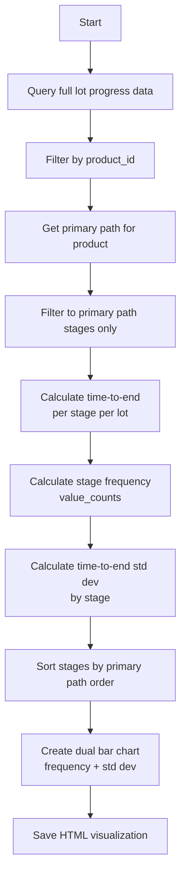

# Time-to-End Variance Analysis

## Overview

Analyzes the variability of remaining time to lot completion at each manufacturing stage. High variance stages indicate inconsistent flow and potential process instability, helping identify quality control and scheduling issues.

## Core Function

### `plot_stage_stats(pid)`

**Location**: `wip_analysis/bottleneck/time_to_end_var.py`

Generates visualization showing:
1. **Stage frequency**: How often lots are observed at each stage
2. **Time-to-end standard deviation**: Variability in remaining completion time

#### Parameters
```python
pid (str): Product identifier (required, cannot be "ALL")
```

#### Return Value
```python
plotly.graph_objs._figure.Figure  # Interactive Plotly figure

# Also saves HTML to:
# outputs/bottleneck/time_to_end_var/<product_id>.html
```

#### Example Usage
```python
from wip_analysis.bottleneck.time_to_end_var import plot_stage_stats

# Analyze time-to-end variance for specific product
fig = plot_stage_stats(pid="xQW3Q+zAOgHWrjqKf97FHQ==")

# Output saved to:
# outputs/bottleneck/time_to_end_var/xQW3Q+zAOgHWrjqKf97FHQ==.html
```

## Processing Logic



## Implementation Details

### Step 1: Data Query & Filtering

**SQL Template**: `get_full_data.sql.j2`

```sql
SELECT 
    product_id,
    lot_id,
    stage,
    created_at
FROM lot_progress
ORDER BY lot_id, created_at
```

**Filter to Product**:
```python
df = fetch_data(render_sql("get_full_data.sql.j2")).to_pandas()
df = df[df["product_id"] == pid]
```

**Filter to Primary Path Stages**:
```python
x_axis_order = get_pid_primary_path(pid=pid)
# e.g., ['DIFF', 'LITHO', 'ETCH', 'CLEAN', 'MEASURE', 'PACK']

df = df[df["stage"].isin(x_axis_order)]
```

**Rationale**: Focus on expected manufacturing path, exclude outlier/rework stages

### Step 2: Time-to-End Calculation

**Function**: `get_time_to_end(df)`

**Purpose**: For each stage observation, calculate days remaining until lot completion

#### Algorithm

```python
def get_time_to_end(df):
    # Sort by lot_id and created_at
    df_sorted = df.sort_values(["lot_id", "created_at"])
    
    # Identify end-of-stage timestamps
    # (when stage changes or lot ends)
    stage_ends = df_sorted["stage"] != df_sorted["stage"].shift(-1)
    lot_ends = df_sorted["lot_id"] != df_sorted["lot_id"].shift(-1)
    
    # Keep only end-of-stage rows
    result_df = df_sorted.loc[stage_ends | lot_ends, cols].copy()
    
    # Find completion time (max created_at) per lot
    completion_time = result_df.groupby("lot_id")["created_at"].transform("max")
    
    # Calculate remaining time in days
    result_df["time_to_end"] = (completion_time - result_df["created_at"]).dt.days
    
    return result_df
```

#### Example

**Input Data** (sorted by lot, time):
```
lot_id | stage    | created_at
-------|----------|-------------------
LOT001 | DIFF     | 2024-01-01 08:00
LOT001 | DIFF     | 2024-01-02 08:00  ← Still in DIFF
LOT001 | LITHO    | 2024-01-03 08:00  ← Stage change
LOT001 | LITHO    | 2024-01-04 08:00
LOT001 | ETCH     | 2024-01-05 08:00  ← Stage change
LOT001 | CLEAN    | 2024-01-10 08:00  ← Stage change
LOT001 | MEASURE  | 2024-01-15 08:00  ← Stage change
LOT001 | PACK     | 2024-01-20 08:00  ← Stage change
                                        ← Lot ends
```

**End-of-Stage Detection**:
```
lot_id | stage    | created_at          | stage_ends? | lot_ends?
-------|----------|---------------------|-------------|----------
LOT001 | DIFF     | 2024-01-01 08:00    | No          | No
LOT001 | DIFF     | 2024-01-02 08:00    | Yes (→LITHO)| No
LOT001 | LITHO    | 2024-01-03 08:00    | No          | No
LOT001 | LITHO    | 2024-01-04 08:00    | Yes (→ETCH) | No
LOT001 | ETCH     | 2024-01-05 08:00    | Yes (→CLEAN)| No
LOT001 | CLEAN    | 2024-01-10 08:00    | Yes (→MEAS) | No
LOT001 | MEASURE  | 2024-01-15 08:00    | Yes (→PACK) | No
LOT001 | PACK     | 2024-01-20 08:00    | No          | Yes
```

**Output** (end-of-stage records with time_to_end):
```
lot_id | stage    | created_at          | time_to_end (days)
-------|----------|---------------------|-------------------
LOT001 | DIFF     | 2024-01-02 08:00    | 18  (20 - 2)
LOT001 | LITHO    | 2024-01-04 08:00    | 16  (20 - 4)
LOT001 | ETCH     | 2024-01-05 08:00    | 15  (20 - 5)
LOT001 | CLEAN    | 2024-01-10 08:00    | 10  (20 - 10)
LOT001 | MEASURE  | 2024-01-15 08:00    | 5   (20 - 15)
LOT001 | PACK     | 2024-01-20 08:00    | 0   (20 - 20)
```

**Interpretation**:
- When LOT001 exits DIFF (day 2), it has 18 days until completion
- When LOT001 exits LITHO (day 4), it has 16 days until completion
- Pattern allows us to see how much time remains at each stage

#### Multi-Lot Example

```
lot_id | stage    | created_at          | time_to_end (days)
-------|----------|---------------------|-------------------
LOT001 | DIFF     | 2024-01-02 08:00    | 18
LOT002 | DIFF     | 2024-01-02 10:00    | 25  (different lot, different time)
LOT003 | DIFF     | 2024-01-03 08:00    | 15
LOT001 | LITHO    | 2024-01-04 08:00    | 16
LOT002 | LITHO    | 2024-01-05 10:00    | 22
LOT003 | LITHO    | 2024-01-06 08:00    | 12
```

**Analysis**:
- DIFF stage: time_to_end varies from 15 to 25 days (range: 10 days)
- LITHO stage: time_to_end varies from 12 to 22 days (range: 10 days)
- High variance indicates inconsistent flow

### Step 3: Stage Frequency Calculation

**Algorithm**:
```python
stage_counts = df_processed["stage"].value_counts().reset_index()
stage_counts.columns = ["stage", "count"]

# Reorder by primary path
stage_counts = stage_counts.set_index("stage").reindex(x_axis_order).reset_index()
```

**Example**:
```python
# After value_counts:
stage    | count
---------|-------
LITHO    | 850
ETCH     | 820
DIFF     | 800
MEASURE  | 780
CLEAN    | 750
PACK     | 700

# After reindex (primary path order):
stage    | count
---------|-------
DIFF     | 800
LITHO    | 850
ETCH     | 820
CLEAN    | 750
MEASURE  | 780
PACK     | 700
```

### Step 4: Time-to-End Standard Deviation

**Algorithm**:
```python
stds = df_processed.groupby("stage")["time_to_end"].std().reset_index()
stds.columns = ["stage", "std"]

# Reorder by primary path
stds = stds.set_index("stage").reindex(x_axis_order).reset_index()
```

**Example Calculation**:
```python
# For DIFF stage:
time_to_end values: [18, 25, 15, 20, 22, 17, 19, 24, 16, 21]
mean = 19.7 days
std = 3.3 days

# For LITHO stage:
time_to_end values: [16, 22, 12, 18, 20, 15, 17, 21, 14, 19]
mean = 17.4 days
std = 3.1 days

# For MEASURE stage:
time_to_end values: [5, 5, 4, 5, 12, 4, 5, 15, 5, 4]
mean = 6.4 days
std = 3.9 days  ← HIGH VARIANCE (range: 4-15 days)
```

**Output**:
```python
stage    | std (days)
---------|------------
DIFF     | 3.3
LITHO    | 3.1
ETCH     | 2.8
CLEAN    | 2.5
MEASURE  | 3.9  ← Highest variance
PACK     | 1.2
```

**Interpretation**:
- **MEASURE**: High std (3.9 days) = inconsistent remaining time
  - Some lots finish quickly after MEASURE (4 days)
  - Others take much longer (15 days)
  - Indicates process instability or routing variations

- **PACK**: Low std (1.2 days) = consistent remaining time
  - Lots finish ~1 day after PACK (predictable)
  - Indicates stable end-of-line process

## Visualization

### Output File
```
outputs/bottleneck/time_to_end_var/<product_id>.html
```

### Plot Structure


### Plotting Function

```python
def plot_stage_stats(pid: str = ""):
    # ... data processing ...
    
    # Create subplots with shared x-axis
    fig = make_subplots(
        rows=2, cols=1, 
        shared_xaxes=True, 
        vertical_spacing=0.05, 
        row_heights=[0.3, 0.7]
    )
    
    # Top: Stage frequency
    stage_counts = df_processed["stage"].value_counts().reset_index()
    stage_counts.columns = ["stage", "count"]
    
    if x_axis_order:
        stage_counts = stage_counts.set_index("stage").reindex(x_axis_order).reset_index()
    
    fig.add_trace(
        go.Bar(x=stage_counts["stage"], y=stage_counts["count"], name="Frequency"),
        row=1, col=1
    )
    
    # Bottom: Standard deviation
    stds = df_processed.groupby("stage")["time_to_end"].std().reset_index()
    stds.columns = ["stage", "std"]
    
    if x_axis_order:
        stds = stds.set_index("stage").reindex(x_axis_order).reset_index()
    
    fig.add_trace(
        go.Bar(x=stds["stage"], y=stds["std"], name="Std Dev"),
        row=2, col=1
    )
    
    # Update layout
    fig.update_layout(
        title_text=f"Frequency & Std of Time to End <Product ID = {pid}>",
        showlegend=False
    )
    fig.update_xaxes(title_text="Stage", row=2, col=1)
    fig.update_yaxes(title_text="Frequency", row=1, col=1)
    fig.update_yaxes(title_text="Std Dev", row=2, col=1)
    
    fig.write_html(f"outputs/bottleneck/time_to_end_var/{pid.replace('/', '_')}.html")
    
    return fig
```

## Interpretation Guidelines

### Standard Deviation Thresholds

| Std Dev (days) | Interpretation | Suggested Action |
|----------------|----------------|------------------|
| < 2 | **Very consistent** | Process is stable, no action needed |
| 2 - 3 | **Moderately consistent** | Monitor for trends |
| 3 - 5 | **Inconsistent** | Investigate root causes |
| > 5 | **Highly variable** | Immediate investigation required |

### Common Patterns

#### Pattern 1: High Variance Early, Low Variance Late
```
Stage    | Std Dev
---------|--------
DIFF     | 4.5 ← High
LITHO    | 3.8
ETCH     | 2.9
CLEAN    | 2.2
MEASURE  | 1.5 ← Low
PACK     | 1.0
```

**Interpretation**: 
- Early stages have uncertain remaining time (many possible paths ahead)
- Late stages have predictable remaining time (few steps left)
- **Normal pattern** - not necessarily a problem

#### Pattern 2: Spike at Specific Stage
```
Stage    | Std Dev
---------|--------
DIFF     | 2.1
LITHO    | 2.3
ETCH     | 6.5 ← SPIKE!
CLEAN    | 2.0
MEASURE  | 1.8
PACK     | 1.2
```

**Interpretation**:
- ETCH has abnormally high variance
- Some lots move quickly through ETCH, others get stuck
- **Problem indicator** - investigate ETCH process

**Possible Root Causes**:
- Equipment variability (some tools faster than others)
- Recipe complexity (different etch types with different durations)
- Rework loops (some lots rework at ETCH)
- Hold/release patterns (lots held for engineering review)

#### Pattern 3: Uniformly High Variance
```
Stage    | Std Dev
---------|--------
DIFF     | 4.5
LITHO    | 5.2
ETCH     | 4.8
CLEAN    | 5.1
MEASURE  | 4.9
PACK     | 4.2
```

**Interpretation**:
- All stages have high variance
- Unpredictable overall flow
- **Systemic issue** - poor scheduling, batching, or priorities

## Use Cases

### 1. Identify Unstable Stages

```python
from wip_analysis.bottleneck.time_to_end_var import plot_stage_stats

# Generate analysis
fig = plot_stage_stats(pid="xQW3Q+zAOgHWrjqKf97FHQ==")

# Manual inspection of plot:
# - Look for tall bars in bottom panel (high std dev)
# - Cross-reference with frequency (top panel)
# - Stages with high frequency AND high variance are priorities
```

### 2. Compare Before/After Process Change

```python
# Before process improvement (historical data)
# Filter data to date range before change
df_before = df[df["created_at"] < "2024-06-01"]
# ... run analysis ...
# Output: ETCH std = 6.5 days

# After process improvement (recent data)
df_after = df[df["created_at"] >= "2024-06-01"]
# ... run analysis ...
# Output: ETCH std = 2.8 days

# Result: 57% reduction in variance (improvement confirmed!)
```

### 3. Product Comparison

```python
# Compare variance across products
for pid in ["HB123", "HB456", "HB789"]:
    fig = plot_stage_stats(pid=pid)
    # Compare visualizations

# Example findings:
# - HB123: MEASURE has high variance (4.2 days)
# - HB456: MEASURE has low variance (1.5 days)
# - Conclusion: MEASURE variance is product-specific, not equipment issue
```

### 4. Prioritize Improvement Projects

```python
# Step 1: Identify bottleneck candidates
from wip_analysis.bottleneck.wafer_qty_by_day import get_bottleneck_candidates

bottlenecks = get_bottleneck_candidates(pid="HB123", status="Active", 
                                       ratio_to_max=0.6, top_k=10)
# Output: ['LITHO', 'ETCH', 'MEASURE', 'CLEAN', ...]

# Step 2: Check variance for these bottlenecks
fig = plot_stage_stats(pid="HB123")
# Manually inspect std dev for bottleneck stages

# Step 3: Prioritize stages with both:
#   - High frequency (bottleneck candidate)
#   - High variance (unstable process)

# Example decision:
# - LITHO: High freq, low variance → Capacity issue (add tools)
# - ETCH: High freq, high variance → Stability issue (improve process control)
# - MEASURE: Low freq, high variance → Low priority
```

## Advanced Analysis

### Calculate Coefficient of Variation

```python
# CoV = std / mean (normalized measure of variance)

df_processed = get_time_to_end(df)

stage_stats = df_processed.groupby("stage")["time_to_end"].agg(["mean", "std"])
stage_stats["cov"] = stage_stats["std"] / stage_stats["mean"]
stage_stats = stage_stats.sort_values("cov", ascending=False)

print(stage_stats.head())

# Output:
#          mean   std    cov
# stage                      
# MEASURE  6.4    3.9    0.61  ← Highest CoV (most variable relative to mean)
# ETCH     10.2   5.1    0.50
# LITHO    17.4   3.1    0.18
# PACK     5.0    1.2    0.24
```

**Interpretation**: CoV > 0.5 indicates high relative variability

### Identify Outlier Lots

```python
# Find lots with extreme time-to-end at specific stage

df_processed = get_time_to_end(df)
etch_data = df_processed[df_processed["stage"] == "ETCH"]

mean_time = etch_data["time_to_end"].mean()
std_time = etch_data["time_to_end"].std()

# Flag outliers (> 2 std from mean)
outliers = etch_data[
    (etch_data["time_to_end"] < mean_time - 2*std_time) |
    (etch_data["time_to_end"] > mean_time + 2*std_time)
]

print(f"Outlier lots at ETCH: {outliers['lot_id'].unique()}")
# Output: ['LOT042', 'LOT183', 'LOT291']

# Investigate these lots for root cause
```

## Performance Considerations

- **Query Time**: ~1-3 seconds for full product data
- **Memory**: Loads all lot progress for product into memory
- **Primary Path Dependency**: Requires `get_pid_primary_path()` (cached)
- **Visualization**: Plot generation adds ~1-2 seconds

## Limitations

1. **Product-Specific**: Cannot analyze "ALL" products (requires single primary path)
   
2. **Primary Path Filtering**: Excludes rework/variant stages
   - May miss variance from non-standard routing
   - Consider analyzing without filtering for complete picture

3. **End-of-Stage Granularity**: Uses stage exit time, not entry time
   - Variance reflects "how much time left after exiting stage"
   - Not the same as "time spent in stage" (see stage duration analysis)

4. **Completion Time Definition**: Uses max(created_at) as completion
   - May not capture true ship date if snapshots end early
   - Consider filtering to lots with terminal stages

5. **No Temporal Segmentation**: Aggregates all time periods
   - Variance may change over time (seasonality, process drift)
   - Consider time-windowed analysis for trends

## Complementary Analyses

### Combine with Stage Duration

```python
# Time-to-end variance shows REMAINING time variability
# Stage duration shows TIME SPENT in stage

from wip_analysis.hwm.product_level import get_stage_duration

# High time-to-end variance at ETCH
duration_stats = get_stage_duration(stage_name="ETCH", product_id="HB123")

# Check if ETCH itself is variable, or downstream stages are variable
```

### Combine with Bottleneck Analysis

```python
# High variance + high WIP = priority for improvement

from wip_analysis.bottleneck.wafer_qty_by_day import get_bottleneck_candidates

bottlenecks = get_bottleneck_candidates(pid="HB123", status="Active", 
                                       ratio_to_max=0.6, top_k=5)
# ['LITHO', 'ETCH', 'MEASURE']

# Check variance for these stages
fig = plot_stage_stats(pid="HB123")

# Decision matrix:
# - LITHO: High WIP, low variance → Add capacity
# - ETCH: High WIP, high variance → Improve process + add capacity
# - MEASURE: Low WIP, high variance → Improve process only
```

## Related Functions

- `get_bottleneck_candidates()` - Identifies high-WIP stages
- `get_stage_duration()` - Analyzes time spent in stage
- `get_pid_primary_path()` - Defines expected stage sequence

## Related Documentation

- [12-bottleneck-candidates.md](./12-bottleneck-candidates.md) - Bottleneck identification
- [04-stage-duration.md](./04-stage-duration.md) - Stage cycle time analysis
- [10-primary-path.md](./10-primary-path.md) - Primary path calculation
